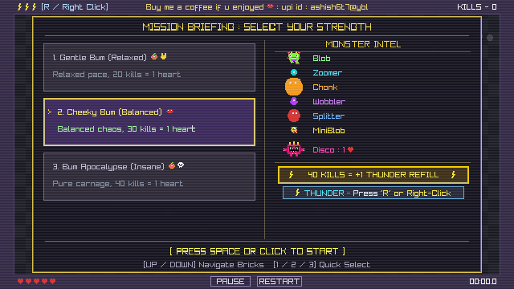

# DontTouchMyBum 🍑👾

<p align="center">
  
  
</p>

> **Protect your bums for $1... spoiler: you won't last. Swarms of nasty monsters want that peach, and I dare you to reach 789 kills in level 3 without getting your peach grabbed and clapped. 🍑😈 Zero install, just double-click to play.**

A deliberately ridiculous, endless, single-screen top-down 90s-arcade shooter. You launch it and you are instantly playing. Monsters pour in from the screen edges to grab your cheeks. You hold the mouse button and a gun with unlimited ammo spews out hilarious sounds. The longer you live, the nastier it gets!

---

# Protect your BUMS 🍑 and hit 789 KILLS to claim the BOUNTY, Someone's trying to EAT it 💀, Goooooo.........

---

## 🌐 Play Instantly in Your Browser (No Download Required!) ⚡

### 👉 [**Click Here to Play DontTouchMyBum in Browser**](https://ashish6t7.github.io/DontTouchMyBum/) 🍑👾


*Zero installation, zero setup, full 60fps arcade graphics & funny sound effects — simply open the link and defend your bums!*

---

## 🎮 Download & Play (v2.0.0 — Latest Release) ⚡

No installation required! Just download, extract, and double-click to play:

| Platform | Download Link | File Size | How to Play |
|:---:|:---:|:---:|---|
| **🪟 Windows** | [**Download Windows ZIP (v2.0.0)**](https://github.com/ashish6t7/DontTouchMyBum/releases/download/v2.0.0/DontTouchMyBum-Windows.zip) | ~639 KB | Unzip and double-click `DontTouchMyBum.exe` |
| **🍏 macOS** | [**Download macOS ZIP (v2.0.0)**](https://github.com/ashish6t7/DontTouchMyBum/releases/download/v2.0.0/DontTouchMyBum-macOS.zip) | ~528 KB | Unzip and open `DontTouchMyBum.app`<br>*(First run: Right-click > Open)* |
| **🐧 Linux** | [**Download Linux ZIP (v2.0.0)**](https://github.com/ashish6t7/DontTouchMyBum/releases/download/v2.0.0/DontTouchMyBum-Linux.zip) | ~692 KB | Unzip, make executable (`chmod +x DontTouchMyBum`), and run `./DontTouchMyBum` |

*(Compatible with Windows 10/11, macOS Apple Silicon & Intel, and all Linux distros: Ubuntu, Kubuntu, Debian, Arch, Fedora).*

<details>
<summary><b>📦 Looking for older releases? (v1.0.0)</b></summary>

| Platform | Legacy Download (v1.0.0) |
|:---:|---|
| **Windows** | [DontTouchMyBum-Windows.zip (v1.0.0)](https://github.com/ashish6t7/DontTouchMyBum/releases/download/v1.0.0/DontTouchMyBum-Windows.zip) |
| **macOS** | [DontTouchMyBum-macOS.zip (v1.0.0)](https://github.com/ashish6t7/DontTouchMyBum/releases/download/v1.0.0/DontTouchMyBum-macOS.zip) |
| **Linux** | [DontTouchMyBum-Linux.zip (v1.0.0)](https://github.com/ashish6t7/DontTouchMyBum/releases/download/v1.0.0/DontTouchMyBum-Linux.zip) |

</details>

---

## 🍼 New in Version 2.0.0: Choose Your Strength!

At the start of the game, select your difficulty directly from the 3 visible interactive brick cards via **`UP` / `DOWN` / `W` / `S` / `1,2,3`** or **mouse click**, and start with **`SPACE`** or **`ENTER`**:

| Difficulty Level | Health & Healing | Style |
|---|:---:|---|
| **`1. Virgin Peach 🍑✨`** | **6 Hearts**, Heals every **20 kills** | Relaxed, fun, and beginner-friendly arcade blasting |
| **`2. Spank Me Daddy 😈💋`** *(Default)* | **5 Hearts**, Heals every **30 kills** | Balanced, engaging arcade challenge |
| **`3. Total Peach Carnage 🍑🩸💀`** | **5 Hearts**, Heals every **40 kills** | Pure brutal hardcore chaos |

### Additional Upgrades in v2.0.0:
* **⚡ Thunder Ability (`[T]` key):** Ordinary BUM 🍑 protection wasn't enough, so hold `T` to unleash a devastating golden nuclear shockwave that vaporizes all on-screen monsters into sparks.
* **🔊 New Funny Sound Effects** 
* **💥 Sharp Bullet Visuals:** Real aerodynamic cartridge projectiles with supersonic luminous tracer streaks.
* **⚡ Faster Fire Rate**
* **👾 Monster Guide:** Full monster guide preserved right on the start screen alongside the difficulty bricks with live dynamic healing thresholds.

---

# I need some help too...

* Guys and Gurls, I have to go through a serious medical surgery due to a condition I have, so if u contribute even few pennies, it will be very helpful. look 😁, u don't have too, it's totally up to u.
* UPI ID : ```ashish6t7@ybl```
* Now go enjoy the game 💋, the game is 100% free to play so Gooooo, and save your PEACHES 🍑...

---

## 📸 Screenshots

### Gameplay:


### Monster Intel & Startup Guide:


---

## 🕹️ Controls

| Key | Action |
|:---:|---|
| **`W A S D` / Arrow Keys** | Move your shooter (diagonals are speed-normalized) |
| **Mouse Cursor** | Aim your gun |
| **Hold Left Mouse Button** | Continuous rapid-fire (unlimited ammo, no reload) |
| **Hold `T`** | Unleash Thunder nuclear screen-wipe (1 per hold, max 3 charges) |
| **`UP` / `DOWN` / `W` / `S`** | Navigate difficulty brick cards on start screen |
| **`1` / `2` / `3`** | Directly select difficulty level |
| **`SPACE` / `ENTER`** | Start game / confirm selection / Respawn |
| **`R`** | Instant restart (returns to level select & monster briefing) |
| **`P`** | Pause (also auto-pauses on window focus loss) |
| **`M`** | Mute / Unmute audio |
| **`-` / `=`** | Volume down / Volume up |
| **`F2`** | Toggle retro CRT scanlines |
| **`F3`** | Toggle FPS & diagnostic overlay |
| **`F11`** | Toggle borderless fullscreen |
| **`ESC`** | Quit game |

---

## 💖 Healing & The $1 Bounty

* **Kills = +1 Heart:** Restores +1 Heart to keep you alive (20 kills on Kiddo, 30 kills on Not Bad, 40 kills on Save Your Peach)!
* **Vanishing Monster Defense:** When a monster touches your body, it consumes 1 heart and immediately dies and vanishes, triggering a 48px pushback shockwave and invulnerability.
* **💰 The 789 Kills Challenge:** Hit **789 kills** in a single run, send the proof, and claim **$1**. Figure out where to send ✌️
* **☕ Buy Me A Coffee:** UPI ID: `ashish6t7@ybl` 💋
